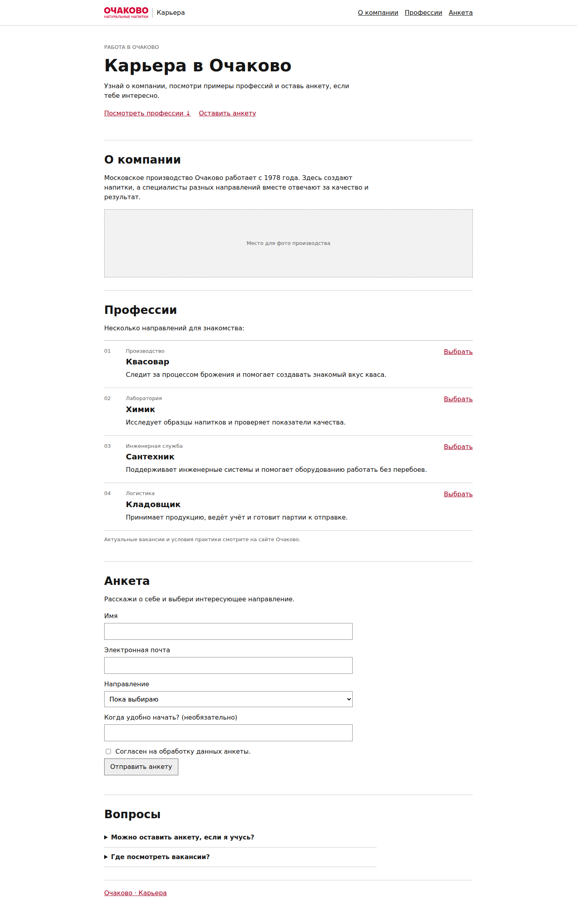
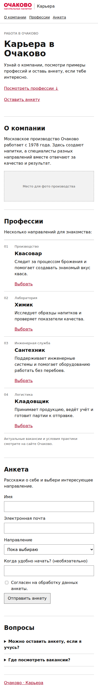

# Карьера в «Очаково»

Первая версия карьерного сайта для хакатона: разделы о компании, профессиях, анкета и FAQ. Анкета сохраняется локально; внешняя HR-система не подключена.

## Запуск

```sh
cd site
./scripts/dev.sh
```

Сайт откроется на http://127.0.0.1:8000. Скрипт предпочитает Python 3.13 и использует Python из активного окружения, если 3.13 не установлен. Подробности — в [`site/README.md`](site/README.md).

## Скриншоты

Полная страница на компьютере:



Мобильная версия:



