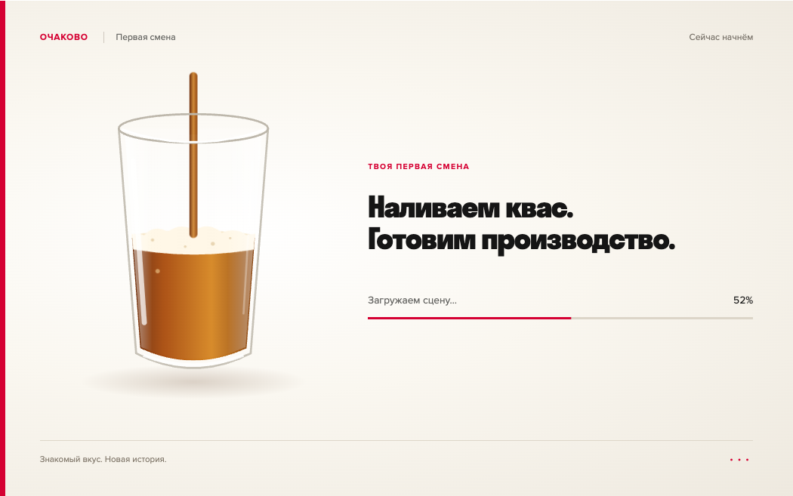

# Загрузка сцены: наливаем квас

После окончания или пропуска профессионального видео игровое окно показывает прозрачный стакан: янтарный квас поднимается, на поверхности пена, внутри пузырьки. Короткий заголовок и проценты остаются читаемыми. Размер окна 16:10 сохранён; загрузка сразу центрируется по высоте браузера.

Уровень монотонно следует реальным сообщениям `progress` от Unity, с плавным визуальным сглаживанием. До события `ready` максимум 96%; затем стакан заполняется до 100% и накладка исчезает за 280 мс. Нет таймера с выдуманной скоростью и обязательной долгой заставки. Готовность означает инициализацию игровой сцены, а не только скачанные файлы.

Экран — SVG/CSS и TypeScript (`web/src/kvass-loading.ts`, `game-menu.ts`, `main.css`). Изображения и внешние зависимости не добавлялись. Иллюстрация создана кодом, шрифты — локальные Stratos и Proxima Nova. Это сайт поверх iframe; Unity-проект и его сборка не менялись. Старая полоса загрузки внутри iframe перекрыта до готовности.

При reduced-motion нет струи, волнения пены и движения пузырьков, уровень меняется без сглаживания. В скрытой вкладке и вне игрового окна декоративная анимация приостанавливается. При ошибке загрузки накладка закрывается, выбор персонажа снова доступен для повторной попытки. Он недоступен для случайных нажатий во время загрузки.

`npm run build` проверяет TypeScript и собирает сайт. `node scripts/check-kvass-loading.mjs` проверяет пропуск и естественное окончание ролика, видимость и границы накладки, монотонность уровня, запуск настоящей Unity-сцены, снятие aria-busy, reduced-motion, мобильную компоновку и ошибку с возвратом к выбору. Для кадров 0/52/91% тест отправляет контролируемые сообщения из настоящего iframe; это позволяет проверить уровни независимо от скорости локального диска. Сам запуск игры проверяется отдельно в том же сценарии. Результат — `validation.json`.

Кадры полного окна: `site-loading-start.png`, `site-loading-half.png`, `site-loading-full.png`, `scene-ready.png`. Мобильная компоновка: `mobile-reduced-motion.png`. Физический телефон не проверялся.
