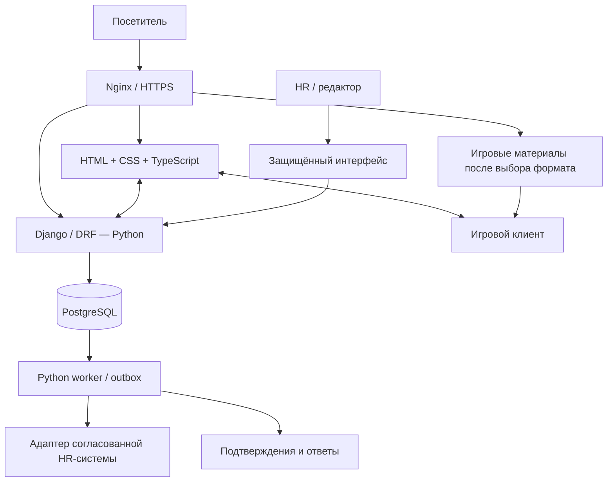

> **Актуальное решение 23 октября 2026:** новый проект Unity WebGL — `OchakovoFactoryWorld`, прогулочная сцена варочного зала по двум референсам пользователя. Реализация, сборка и ограничения: [документ сцены](../game/README.md). В шаблон сайта добавлен запуск WebGL по нажатию; состояние проверки сервера описано в документе сцены.

# Архитектура продукта: Python и игровая часть. **Python и стек сайта подтверждены пользователем; технология игры — Unity WebGL.** Детали контрактов ниже — проектные ориентиры, не уже созданная система. [Обзор](README.md).

## Основное решение

Используем **модульное приложение Django**: одна серверная система с разделёнными областями ответственности, PostgreSQL для данных, серверные HTML-страницы и TypeScript для интерактива. Игра поставляется отдельной статической WebGL-сборкой с загрузчиком и встраивается в сайт через iframe. Игра не отвечает за вакансии и анкеты; серверная логика остаётся в Python.

Такой состав поддерживает и выразительный сайт, и кадровый процесс. Масштаб идеи не ограничен объёмом демонстрации: новые маршруты, площадки, кабинет и интеграции можно добавлять постепенно, сохраняя общую модель данных.

## Утверждённый стек

| Уровень | Предложение | Задача и причина выбора |
|---|---|---|
| Серверный язык | Python 3.13, актуальный совместимый патч при реализации | Бизнес-правила, анкеты, каталог, интеграции, обработка событий |
| Серверный фреймворк | Django 5.2 LTS | Модели, миграции, формы, права и внутренний интерфейс в одной системе |
| API | Django REST Framework | Версионированный контракт сайта, игровых результатов и будущих интеграций |
| Данные | PostgreSQL, поддерживаемая версия на выбранном хостинге | Заявки, предложения, статусы, согласия, задания доставки; транзакционные связи |
| Страницы | Django Templates + обычные HTML/CSS | Быстро доступные тексты и формы, единый источник контента |
| Интерактив сайта | TypeScript + Vite | Фильтры, сравнение, игровой контейнер, события; сборка браузерных модулей |
| Игра | Unity WebGL | Прогулка по объёмной сцене варочного зала; задания добавляются отдельно |
| Доставка сайта | Nginx + Gunicorn + HTTPS | Статические файлы отдельно от Python; запросы приложения через WSGI |
| Упаковка и окружения | Docker Compose, отдельные dev/staging/production | Повторяемая сборка и изоляция настроек/данных |
| Фоновые операции | Python worker с таблицей outbox в PostgreSQL | Доставка заявок и уведомлений, повторы, контроль зависших задач |
| Контент и HR | Django Admin для начала; специальные экраны очереди по мере развития | Редактура, доступы, фильтры; рабочий процесс HR не обязан оставаться набором таблиц |
| Аналитика | Собственные события без контактов + агрегаты в защищённом отчёте | Видеть путь до отклика и обработки; инструмент визуализации выбирается с компанией |
| Проверка | pytest/pytest-django, проверки API и браузерные сценарии | Набор проверок игровой части зависит от выбранной технологии |

Django 5.2 — LTS и поддерживает Python 3.13; выбор этой линии осознанный, не заявление, что это самая новая версия. [Release notes](https://docs.djangoproject.com/en/5.2/releases/5.2/). DRF — предлагаемая надстройка для API, Vite — инструмент браузерной сборки. [DRF](https://www.django-rest-framework.org/), [Vite](https://vite.dev/guide/). PostgreSQL хранит связанные данные приложения. [Документация PostgreSQL](https://www.postgresql.org/docs/current/intro-whatis.html).

Admin предназначен для внутреннего управления; публичный карьерный сайт проектируется отдельно. [Django Admin](https://docs.djangoproject.com/en/5.2/ref/contrib/admin/).

**Почему не добавляю React/Next.js по умолчанию:** текущие сценарии не требуют отдельного SPA и второго серверного приложения. TypeScript достаточно для сайта и его интерактивных компонентов. Если позднее появится сложный личный кабинет или визуальный конструктор маршрутов, React можно применить к этой части. Это вопрос сложности интерфейса, а не ограничение Python.

**Почему пока без отдельного FastAPI, Redis, Celery, Kubernetes и микросервисов:** их функции здесь не требуют отдельных систем. При большом количестве фоновых задач можно заменить/расширить worker очередью; при доказанной нагрузке — добавить кеширование и масштабирование. Наличие этих технологий само по себе не делает идею полнее.

## Схема компонентов



Для размещения предлагаем карьерный поддомен компании или согласованный раздел; конкретный адрес ещё не выбран. При первом варианте свой сервер полностью управляет своим origin. Раздел на основном сайте потребует согласованного reverse proxy; доступ к ochakovo.ru не предполагается автоматически. В обоих случаях визуальная преемственность сохраняется.

## Границы логики

| Игровой клиент | Браузер / TypeScript | Python / Django |
|---|---|---|
| Представление игровой среды и взаимодействия после выбора технологии | Загрузка игрового модуля, формы, фильтры и управление фокусом | Проверенные предложения и карьерный контент |
| Игровые правила после их определения | Передача согласованных сообщений после выбора механик | Правила анкеты, согласий и обработки |
| Визуальные настройки игрового интерфейса | API-запросы и обработка ошибок | Сохранение, права доступа, интеграции |
| Условные игровые результаты после их определения | Адаптация к размерам окна | Проверка схемы событий и статистика |

Браузер и игровой клиент считаются недоверенными источниками: их сообщения можно подделать. Сервер не использует игровые очки для кадрового решения. Правила допустимых вакансий, состояний заявки и доступа исполняются на сервере.

## Игровая часть и страница сайта

Игровой блок на сайте остаётся заглушкой. Игровой проект, сессии, события, сохранения и связь между сайтом и игровым клиентом не реализованы. Способ встраивания, адаптивное поведение и полноэкранный режим определить после выбора технологии.

## Контракт API: первая версия

| Метод и путь | Назначение | Основное ограничение |
|---|---|---|
| `GET /api/v1/roles/` | Направления и подтверждённый контент | Только опубликованное |
| `GET /api/v1/opportunities/?city=…` | Актуальные предложения | Закрытые не маскируются под открытые |
| `POST /api/v1/applications/` | Сохранить отклик | CSRF, серверная валидация, ключ идемпотентности |
| `POST /internal/integrations/hr/status/` | Принять статус от HR-системы | Сервисная аутентификация, защита от повторов |

Это целевые примеры контрактов, а не подтверждение всех опубликованных URL. Игровые события и интеграционные endpoints добавлять после выбора сценария и согласования данных.

Для статуса кандидата в расширении нужен защищённый кабинет/одноразовая ссылка с ограниченным сроком. Публичного `GET` по угадываемому номеру обращения нет. Номер на экране — ориентир для общения, не ключ доступа к персональным данным.

Единая структура ошибки: код, понятное сообщение, ошибки полей, идентификатор обращения в поддержку без персональных данных. Коды состояния различают неверные данные, ограничение частоты, закрытую вакансию и временный сбой. Приложение не возвращает «успешно» до фиксации транзакции.

## Модель данных

| Сущность | Основное содержание | Связь и смысл |
|---|---|---|
| `Location` | Город, площадка | У направления может быть несколько площадок |
| `Role` | Задачи, описание, обучение, проверивший редактор | Стабильная профессия/область |
| `Opportunity` | Role, Location, сроки, требования, условия, статус, обновление | Конкретная открытая возможность; не равно Role |
| `Campaign` | Источник, размещение, сезон | Атрибуция входа без контактов |
| `VisitorSession` | Непрозрачный ID, допустимые настройки, срок жизни | Анонимная сессия браузера |
| `Application` | Контакт, доступность, предложение, текущий статус | Защищённый кадровый объект |
| `ConsentReceipt` | Версия текста, назначение, время | Связан с конкретной отправкой/подпиской |
| `ApplicationStatusHistory` | Кто, когда, переход, причина | Аудит процесса и метрики |
| `OutboxMessage` | Тип действия, ссылка на заявку, повторы, результат | Надёжная доставка без копирования контактов в логи |
| `ContentRevision / StaffAudit` | Версия публикации и служебные изменения | Актуальность материалов и контроль доступа |

При желании измерять связь игры с откликом связываем только допустимые технические идентификаторы с понятной политикой обработки. Контакты не попадают в payload аналитики, URL и имена событий. Сроки хранения разных категорий определяются до запуска и реализуются задачами удаления, а не словом «анонимно» в интерфейсе.

## Отклик и надёжная передача HR

Одна транзакция создаёт `Application`, запись согласия и `OutboxMessage`. После commit пользователь видит «Заявка сохранена». Worker забирает задачу с блокировкой/арендой, передаёт во внешний сервис и записывает результат. При временной ошибке — повтор с увеличением интервала, лимитом попыток и очередью ручного разбора.

Внешний идентификатор заявки остаётся тем же при повторах. Если HR-система поддерживает идемпотентность — используем её. Если не поддерживает, нужны сверка внешнего ID и обработка неопределённого результата, иначе повтор после тайм-аута может создать дубль. Нельзя обещать «ровно один раз» без такого контракта.

Пока HR-система неизвестна, рабочий путь — защищённая внутренняя очередь. Письмо «пришла заявка» может содержать ссылку в неё без полного набора персональных данных. Интеграция с конкретной ATS/CRM проектируется после получения API и правил доступа; наличие такого API у «Очаково» не установлено.

## Размещение, версии и эксплуатация

- Nginx обслуживает HTML-статику и игровые материалы после выбора формата; Python обрабатывает бизнес-запросы. Требования к их раздаче определить вместе с технологией игры.
- Выпуски игры следует делать неизменяемыми и версионированными. Сайт переключает версию только после загрузки и проверки всех файлов; API совместим с опубликованными схемами.
- Публичные ассеты могут уйти в согласованное объектное хранилище/CDN при росте трафика. Анкеты и HR-файлы туда публично не помещаются.
- Отдельные staging и production, секреты вне репозитория, база недоступна из публичной сети. Роли HR, редактора и аналитика раздельны; права ограничиваются задачей и при необходимости площадкой.
- Резервное копирование базы и проверка восстановления; миграции с планом отката; мониторинг ошибок API, очереди доставки, закрывшихся предложений и времени ответа HR.
- Ограничения частоты и размера входа, CSRF при cookie-сессиях, строгая проверка файлов/контента, журналирование без контактов. Доступ сотрудников через согласованный механизм с усиленной аутентификацией.

## Мобильные устройства и следующий этап

При выборе формата игры нужно заложить мобильный сценарий, читаемый текст, клавиатурное управление и отключение лишней анимации. Проверить загрузку и управление на согласованных iOS/Android устройствах до подключения игры на страницу.

## Текущая структура проекта

```text
backend/
  config/                   # настройки и маршруты
  apps/content/             # направления, истории, версии
  apps/opportunities/       # площадки и предложения
  apps/applications/        # анкеты, статусы, права
  apps/integrations/        # outbox и HR-адаптеры
  apps/analytics/           # разрешённые события и агрегаты
web/
  templates/ styles/ src/   # сайт
infra/                      # окружения и доставка
docs/                       # решения и спецификации
```

Сайт и сервер находятся в `backend/` и `web/`. Игрового проекта сейчас нет; команды разработки сайта описаны в [инструкции разработки](../DEVELOPMENT.md). Документация фиксирует принятое решение и текущее состояние кода, но не заменяет проверку реализации.


## Видео, профессии и бренд

Каталог профессий и анкета остаются доступны без игры и видео. Отклик отправляется только после заполнения формы. Актуальные вакансии и предложения должны приходить из проверенного источника с датой актуализации; перечень профессий сам по себе не подтверждает наличие вакансии или практики.

Весь публичный интерфейс использует [общую дизайн-систему](../../brand/design-system.md), [токены](../../brand/tokens.css) и [брендбук](../../brand/brandbook.md).

## Реализованное уточнение

Сайт остаётся одностраничным Django-приложением с профессиями и анкетой; локальный администратор и серверная форма описаны в [DEVELOPMENT.md](../DEVELOPMENT.md). WebGL-контейнер подключён к шаблону страницы; игра не отправляет игровые события. Новый проект OchakovoFactoryWorld создан по следующему запросу пользователя от 23 октября: Unity WebGL, прогулка по варочному залу.
